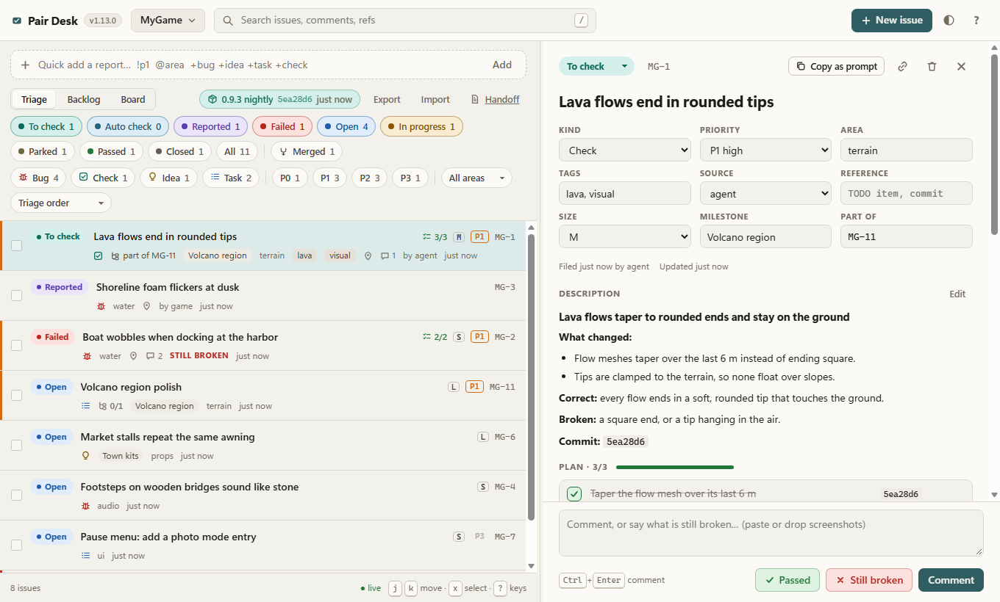
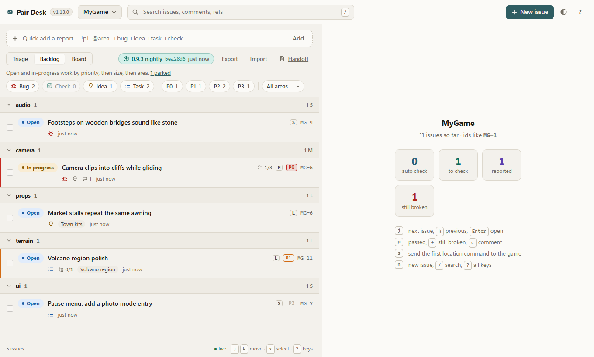
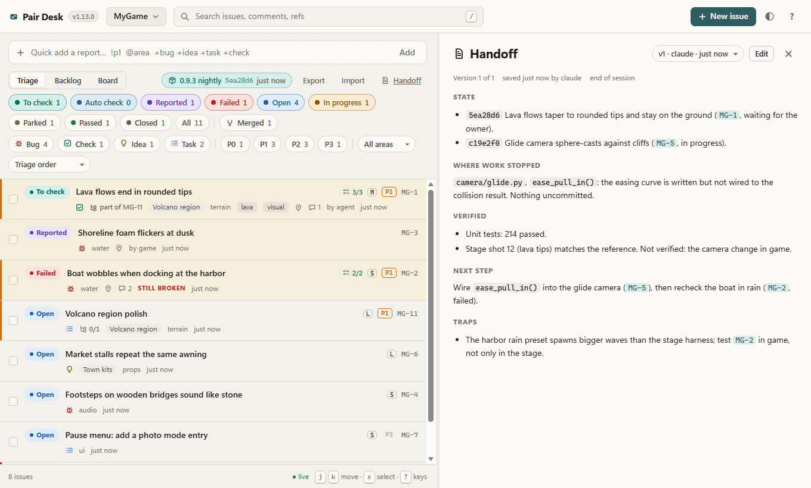
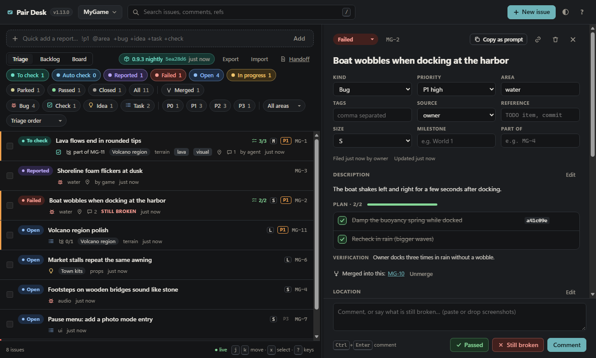

<p align="center"></p>

<h1 align="center">Pair Desk</h1>

<p align="center">
  <b>The playtest desk, backlog and handoff you share with your coding agents.</b><br>
  You play the game, your agents write the code. Pair Desk is the table between you.<br>
  For Claude Code, Codex, opencode, Google Antigravity and Meta Muse Code, with any engine.
</p>

<p align="center">
  <a href="https://pair-desk.renner.dev"><b>pair-desk.renner.dev</b></a> ·
  <a href="#install">Install</a> ·
  <a href="#documentation">Documentation</a> ·
  <a href="CHANGELOG.md">Changelog</a> ·
  <a href="https://github.com/rennerdo30/pair-desk/issues">Issues</a> ·
  <a href="LICENSE">MIT license</a>
</p>



## What it does

Agents forget everything between sessions, and they can't see your game. Pair Desk gives both
sides one place to meet:

- Agents file **checks** ("verify the lava flows now end in rounded tips") with the game's own
  chat command that takes you to the spot.
- You press **Send to game**, the running game teleports you there, and you answer **Passed** or
  **Still broken**, with pasted screenshots.
- You and the game file **reports** (bugs, ideas, tasks). Agents read them and your verdicts at the
  start of their next session, and hear about new ones on their next prompt, or live.
- Every issue carries the agent's **plan** (steps ticked as commits land); each project keeps a
  versioned **handoff** (where work stopped, next step, traps) and a sized, prioritised **backlog**.
- Everything is **live**: what the game, an agent or another tab writes shows up within a second.

## How it works

```
  you, in the browser                       your coding agents
  triage · backlog · handoff                Claude Code, Codex, opencode, Antigravity, Muse
  Passed / Still broken / Send to game      MCP tools, skills, session and prompt hooks
            │                                         │
            └──────────────┐           ┌──────────────┘
                           ▼           ▼
             Pair Desk (127.0.0.1:8765, Python 3.11+ standard library)
             one data folder: desk.sqlite and your screenshots
                           ▲
                           │  POST a report with the spot · poll for queued commands
                  your game's dev console
```

By default it is entirely local: one data folder with a SQLite file and your screenshots, a
standard-library Python server, a plain HTML/JS web UI with no build step, no CDN and no
telemetry. The server listens on `127.0.0.1` only. It works for several games at once and knows
nothing about any particular engine: locations are your game's own console commands.

Optional [Git project sharing](docs/git-sync.md) synchronizes selected projects across PCs through
a dedicated data branch in their existing repository. It uses Git authentication and stays
disabled until explicitly configured.

## Features

| | |
|---|---|
| **Checks with a place** | Each check lists the game's console commands, one place each, with a label. *Copy* or *Send to game* per command; the desk shows when the game picked it up. |
| **Plans before code** | Agents write the plan on the issue before they start and tick steps as commits land. A check can't reach you while steps are open or without a location. |
| **Verdicts only you give** | Agents can't mark anything *passed*; the tools refuse it. *Still broken* moves the check back and reaches the agent before its next prompt. |
| **Agents check first** | `auto_check` is the agent's own queue (screenshots, logs, tests, builds). Only what needs your eyes moves to *To check*. |
| **Handoff** | One versioned document per project: state, where work stopped, verified, next step, traps. Every save is kept and diffable; session start shows the next step and traps. |
| **Backlog** | Open work by priority, then size, then area, in collapsible groups. Replaces the hand-kept TODO file. |
| **Who hears the owner** | A session-start summary, a prompt hook with your activity since the agent last looked, and a live channel into idle Claude Code sessions. One lead client per project; delegated jobs stay quiet. |
| **Builds** | A build script publishes the current build; waiting checks record the build they were handed over in, with *Open folder* and *Run*. |
| **Merge and group** | Merge duplicate reports with their history, group work under a parent with child progress, and get grouping proposals. |
| **Search** | Ranked full-text search over titles, details, bodies and comments, with stemming, phrases and a substring fallback for code names. |
| **Keyboard first** | `j`/`k` move, `s` sends to the game, `p` passed, `f` still broken. After *Passed* the next check opens. |
| **Backup, transfer, sharing** | A one-zip backup while it runs, verified restore, topic export and import with full history, and optional Git sharing across PCs. |

| | |
|---|---|
|  |  |
| **Backlog:** open work by priority, size and area | **Handoff:** versioned, with diffs, updated by agents |



<sub>Pair Desk 1.13.0 with the sample desk from `scripts/demo-desk.py`, captured by `scripts/ui-check.mjs`.</sub>

## Install

One command sets it up for every installed agent tool:

```bash
uvx --from git+https://github.com/rennerdo30/pair-desk pair-desk install
```

No uv? Any of these does the same:

```bash
pipx run --spec git+https://github.com/rennerdo30/pair-desk pair-desk install
curl -fsSL https://raw.githubusercontent.com/rennerdo30/pair-desk/main/install.sh | sh     # macOS, Linux
```

```powershell
irm https://raw.githubusercontent.com/rennerdo30/pair-desk/main/install.ps1 | iex             # Windows
```

You need **Python 3.11 or newer**. The installer finds which of `claude`, `codex`, `opencode`, `agy`
and `muse` are on your PATH, shows the exact steps for each and asks before running them
(`--yes` skips the questions, `--dry-run` only shows them; name tools to limit it, e.g.
`install claude codex`). It touches only its own entries and backs up every config file it edits.
Then it offers to link the git repo you are in to a desk project, and prints how to start the desk.

`update` and `uninstall` work the same way; uninstall removes only what install added and leaves
the desk's data alone. What each tool gets, installing by hand, and the Codex, opencode,
Antigravity and Muse Code details are in [docs/install.md](docs/install.md).

## Quick start

```bash
git clone https://github.com/rennerdo30/pair-desk && cd agent-pair-programming
python desk.py serve --open                 # the web UI at http://127.0.0.1:8765/
```

On macOS and Linux, `bin/pair-desk` runs the same thing with whichever of `python3` or `python` is
3.11+; on Windows, `bin\pair-desk.cmd`, or double-click `start-desk.cmd`. Inside Claude Code with
the plugin, `/agent-pair-programming:serve` starts the desk in the background.

1. **Create a project** for your game: *New project…* in the project menu, or
   `python desk.py new-project --slug mygame --name MyGame --prefix MG` (issues become `MG-1`, `MG-2`, …).
2. **Link your game repo** so agents working there find the project: put
   `{"project": "mygame"}` in a `.pair-desk.json` at the repo root, or run
   `python desk.py link --project mygame --path /path/to/mygame`.
3. **Work.** Your agents read the desk at session start (the plugin's hook does it), write a plan
   before they code, and file a check with a location command when something is ready for you.
   You open the check, press *Send to game* (or copy the command), look, and answer.
4. Optional: teach your game to **file reports and pick up commands** (see
   [Your game](#your-game)), so a key press in the game files a bug with a screenshot and the
   exact spot.

Want to look around first? `python scripts/demo-desk.py --data /tmp/pd-demo` writes a desk with
sample data; open it with `python desk.py --data /tmp/pd-demo serve --open`.

## Your game

Teach the game two small calls and the loop closes. A key press `POST`s a report with a screenshot
and the chat command that brings a player back to the spot. While the dev console is on, the game
polls `GET /api/projects/{slug}/commands/next?client=<name>` about every 2 seconds and runs what it
gets as if it were typed into chat; each command is delivered once and expires after 10 minutes.
When the desk isn't running the requests fail to connect: back off quietly and never block play.

```
curl -X POST http://127.0.0.1:8765/api/projects/mygame/issues -H "Content-Type: application/json" -d '{
  "title": "Stuck in the rock near the harbor", "kind": "bug", "source": "game", "author": "game",
  "location": {"command": "/goto 1240 12 -380 yaw 90", "x": 1240, "y": 12, "z": -380, "yaw": 90, "place": "Harbor", "time": "17:30"},
  "attachments": [{"filename": "f12.png", "mime": "image/png", "data_base64": "iVBORw0KGgo..."}]}'
```

The full protocol (one place per command, seeds for generated worlds) and every endpoint are in
[docs/api.md](docs/api.md).

## Security model

- **Loopback only.** `serve` binds `127.0.0.1`. Requests from other addresses, with a non-loopback
  `Host` header, or from a web page on another origin get `403`, which also blocks DNS rebinding
  and cross-site requests from sites you visit. Writes are also refused from an opaque `null` origin
  (a sandboxed frame) and from requests the browser marks cross-site.
- **Opening a build's folder or running it** works only on the path the desk stored, only from this
  machine, and only from the desk's own page: it carries a token the server writes into the page it
  serves, which no other page can read. Run starts the executable without a shell or arguments.
- **No accounts, no authentication.** Anything that runs on your computer can use the desk; that is
  the local trust boundary. Optional Git sharing uses the repository's authentication and
  permissions; repository readers can read shared desk contents and writers can change them.
- **`--lan` is for trusted networks only.** `python desk.py serve --lan` listens on all interfaces
  (e.g. to use the desk from your phone). It still has **no authentication**: anyone on that network
  can read, change and delete your issues and screenshots and queue commands for your game. Stop it
  when you are done.
- The HTTP API never reads files from disk; only the local CLI and MCP tools attach files by path
  (images and PDFs, checked by content). HTML in markdown is escaped and the UI runs under a strict
  Content Security Policy. Agents cannot mark anything *passed*: only you give that verdict.

See [SECURITY.md](SECURITY.md) for details and how to report a vulnerability.

## Documentation

| | |
|---|---|
| [Installing](docs/install.md) | What `install` does per tool, installing by hand, the Claude Code plugin (MCP tools, skills, hooks, channel), linking a repo, Codex, opencode, Antigravity and Muse Code |
| [Web UI](docs/web-ui.md) | Every part of the desk in the browser, keyboard shortcuts, automatic verification |
| [Game integration and HTTP API](docs/api.md) | Filing reports, *Send to game*, one place per command, every endpoint |
| [CLI](docs/cli.md) | Running the server, and every command for agents and scripts |
| [Data, search and backup](docs/data.md) | The data folder, search ranking, backup and restore, topic transfer, the data model, migrations |
| [Git project sharing](docs/git-sync.md) | Sharing projects across PCs through a data branch |
| [Topic transfer](docs/topic-transfer.md) | Exporting and importing selected topics |
| [Development](docs/development.md) | Tests, smoke checks, benchmarks and the source layout |
| [Website](website/README.md) | The project homepage in `website/` |

## License

[MIT](LICENSE). Changes are listed in [CHANGELOG.md](CHANGELOG.md).

Claude Code, Codex, opencode, Google Antigravity, Meta Muse Code, GitHub and the other product names
mentioned here are trademarks of their respective owners. Pair Desk is an independent open-source
project and is not affiliated with, sponsored or endorsed by any of them; the names only say which
tools it works with.
